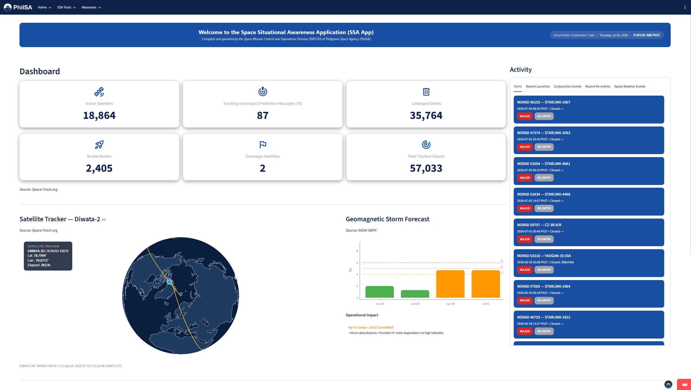

# PhilSA SSA Demo App

**Space Situational Awareness Dashboard**  
*Real-time monitoring and decision-support tool for the Philippine Space Agency*

[](https://https://philsa-smcod-ssa-app-demo.streamlit.app/)

 <!-- Replace with actual screenshot -->

## About This Application

**PhilSA SSA App** is a real-time monitoring and decision-support tool developed to support the **Philippine Space Agency's (PhilSA)** Space Situational Awareness (SSA) operations.

It provides consolidated, near real-time information on **orbital safety**, **re-entry risks**, **launch activities**, and **space weather conditions** to enhance operational monitoring, risk assessment, and decision-making.

In the future, the platform aims to serve researchers, academic institutions, industry partners, and other stakeholders in the Philippine space sector.

---

## What is Space Situational Awareness?

**Space Situational Awareness (SSA)** is the knowledge and characterization of objects and events in outer space. It involves detecting, tracking, and predicting the behavior of satellites, debris, and other orbiting objects to prevent collisions, assess risks, and support safe space operations.

---

## ✨ Key Features

- **Conjunction Analysis** — Monitor close approaches and collision risks (CDM events)
- **Re-entry Monitoring** — Track objects predicted to re-enter Earth's atmosphere
- **Rocket Launch Tracker** — Stay updated with upcoming and recent launches (focus on neighboring countries)
- **Space Weather** — Real-time geomagnetic storm (Kp Index) forecasts

---

## 📊 Data Sources

- Space-Track.org
- NOAA Space Weather Prediction Center (SWPC)
- NASASpaceFlight.com
- Civil Aviation Authority of the Philippines (CAAP)

> **Note**: This is a demonstration dashboard integrating mock and real-time data.

---

## 🚀 How to Run Locally

### Prerequisites
- Python 3.9+
- Streamlit

### Installation

```bash
# Clone the repository
git clone https://github.com/yourusername/philsa-ssa-app.git
cd philsa-ssa-app

# Install dependencies
pip install -r requirements.txt
